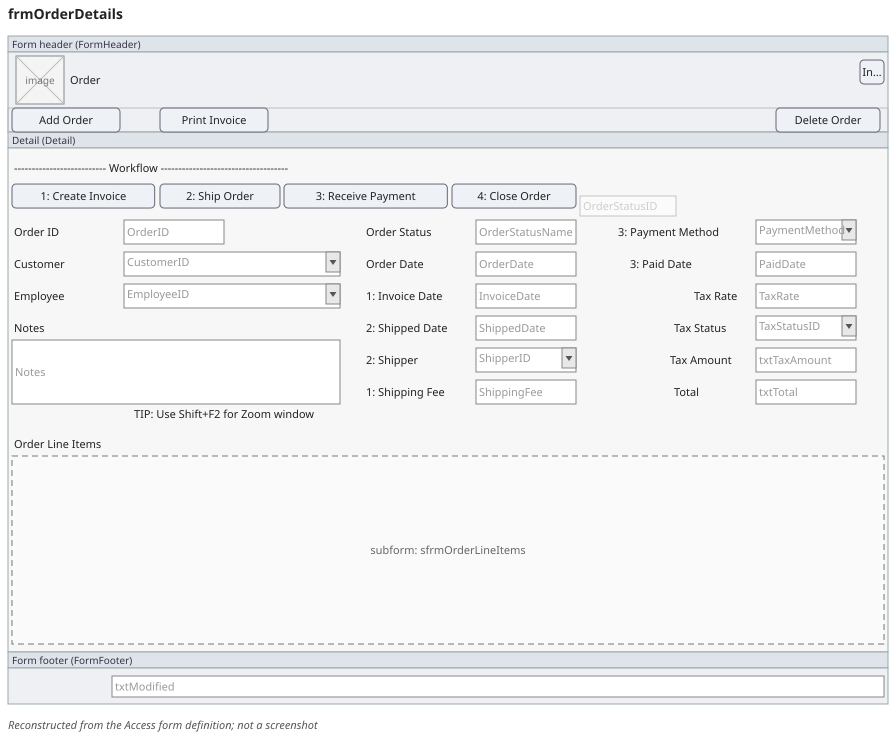
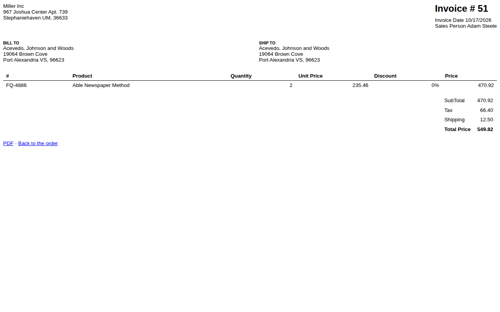

# access-excel-to-django

Demo engagements of the modernization pipeline: an MS Access app and an Excel VBA app rebuilt as Django apps, each with equivalence tests against the original. Each section below belongs to one engagement and is written at its S6 stage.

<!-- engagement:northwind-demo -->
## Northwind: an Access database rebuilt in Django

The original is Microsoft's Northwind 2.0 Developer Edition, an Access database template (.accdt) for a small trading company. Its design holds 28 tables, 65 saved queries, 40 forms, 15 reports, 18 VBA modules (6,886 non-blank lines of VBA), 1 macro and 20 data macros. The Django app in [northwind/](northwind/) keeps its four core areas (orders, inventory, purchasing and reports) and the four workflows the client had to keep: order entry to a printable PDF invoice to shipping, inventory levels and restocking, purchase order to receiving to stock update, and the invoice plus four sales and catalog reports. It runs on PostgreSQL and SQL Server.

### Before and after

| Before: the Access order form, reconstructed from its definition | After: the same order in the Django app |
|---|---|
|  |  |

The before pictures are wireframes drawn from the form definitions, not screenshots, and show no data ([all of them](northwind/docs/img/before/index.md)). The after pictures are screenshots of the new app on synthetic data only: [orders](northwind/docs/img/after/orders-main.png), [inventory](northwind/docs/img/after/inventory-main.png), [purchasing](northwind/docs/img/after/purchasing-main.png), [reports](northwind/docs/img/after/reports-main.png), and every workflow step in the [app README](northwind/README.md#screens).

### Equivalence checks

Each of the 54 kept saved queries of the original is a unit of an equivalence harness. Its reference outputs (the goldens) were recorded by UCanAccess 5.1.8, an open-source engine that reads Access files, running the original's queries on the original data and on three synthetic datasets; they were not recorded by Microsoft Access. The Django app's outputs were compared with them on PostgreSQL and on SQL Server: **the lowest of the 8 cells passed at 1.0** (428 of 428 unit tests; the gate is 0.9 in every cell). 7 of the 54 units use date, formatting or app functions that UCanAccess may evaluate differently from Access, and no confirmation run on Microsoft Access was made for this demo, so for those 7 a pass shows agreement with UCanAccess, not with Access. The rule tests passed 157 of 157 on each database and the end-to-end browser tests 5 of 5. The checks cover the compared query outputs, the written rules and the four workflows, not every behaviour of the original. The full report, with its method and limits: [northwind/docs/equivalence-report.md](northwind/docs/equivalence-report.md).

### Check it yourself

The synthetic-seed checks run on any machine without our tools. With [uv](https://docs.astral.sh/uv/) and a PostgreSQL 16 server:

```sh
cd northwind/app && uv sync
export PG_URL=postgresql://<user>:<password>@127.0.0.1:5432
uv run python -m pytest -c pyproject.toml --rootdir . ../equivalence/tests -p equivalence.plugin \
  --create-db --eq-adapter ../equivalence/adapter.toml --eq-dataset seed-1 --eq-db postgresql \
  --junitxml junit-equivalence-seed-1-postgresql.xml -p no:cacheprovider
DATABASE_URL="$PG_URL/northwind_demo" uv run pytest -q --create-db --ignore=tests/e2e
```

Use `--eq-dataset seed-2` or `seed-3` for the other seeds; [northwind/equivalence/README.md](northwind/equivalence/README.md) and the [app README](northwind/README.md) have the rest, including the end-to-end tests.

### Walkthrough

Video walkthrough: link added at the S6 gate

The narration script is [northwind/docs/walkthrough.md](northwind/docs/walkthrough.md). Licences and credits: [northwind/NOTICE.md](northwind/NOTICE.md).
<!-- /engagement:northwind-demo -->

<!-- engagement:invoicegen-demo -->
<!-- /engagement:invoicegen-demo -->
