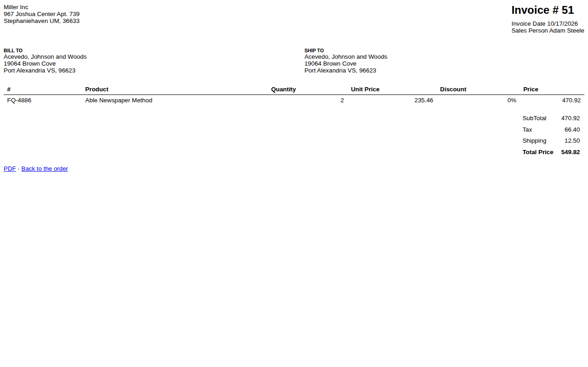

# Northwind

Northwind is an order-management application for a small trading company: it takes customer orders, invoices and ships them, keeps stock levels and restocks through purchase orders, and prints sales reports and a product catalog. This folder rebuilds Microsoft's Northwind 2.0 Developer Edition, an Access database template (.accdt), as a Django web app that runs on PostgreSQL or SQL Server. Its kept queries are checked against reference outputs that UCanAccess, an open-source engine that reads Access files, recorded from the original's queries (not Microsoft Access itself), and its rules and workflows by rule tests and end-to-end tests; [docs/equivalence-report.md](docs/equivalence-report.md) gives the results and their limits. No file, data, VBA or query text of the original is in this repository.

## What it does

The app keeps four areas of the original, each one Django app:

- **`orders`, Orders, Invoicing and Shipping:** the order list and order screen, order lines with stock allocation, invoicing with a printable PDF invoice, shipping, payment and closing; companies, contacts and employees.
- **`inventory`, Products and Inventory:** the product list and product screen with stock figures (physical stock, allocated, on order, quantity to sell), stock takes, vendors per product and reordering.
- **`purchasing`, Purchasing and receiving:** purchase orders from New through Submitted, Approved and Received to Closed, receiving into stock, and the vendor's purchase orders.
- **`reports`, Sales and Catalog Reports:** monthly sales per employee, monthly and quarterly sales per product (with charts) and the product catalog, each as a page and an A4 PDF.

Four workflows, one per item the client must keep:

| Workflow | What it covers |
|---|---|
| `order_to_ship` | Order entry to invoice (printable PDF) to shipping |
| `inventory_restock` | Inventory levels and restocking |
| `purchase_order_to_stock` | Purchase order to receiving to stock update |
| `kept_reports` | The invoice and the four chosen reports |

The foundation under them: sign-in with local accounts (django-allauth, with optional MFA) and two roles that mirror the original's privileges, `staff` and `approver` (who may approve purchase orders). Every behaviour is a numbered rule in [analysis/rules.md](analysis/rules.md) (122 rules); what was kept and dropped is in [analysis/keep-drop.md](analysis/keep-drop.md).

## Screens

After: the new app, on synthetic seed 1 (invented data only).



Main screen of each area: [orders](docs/img/after/orders-main.png), [inventory](docs/img/after/inventory-main.png), [purchasing](docs/img/after/purchasing-main.png), [reports](docs/img/after/reports-main.png).

| Workflow | Steps |
|---|---|
| `order_to_ship` | [01 order list](docs/img/after/order_to_ship-01-order-list.png), [02 new order](docs/img/after/order_to_ship-02-new-order.png), [04 order lines](docs/img/after/order_to_ship-04-order-lines.png), [05 invoice](docs/img/after/order_to_ship-05-invoice.png), [06 ship](docs/img/after/order_to_ship-06-ship.png), [08 closed](docs/img/after/order_to_ship-08-closed.png) |
| `inventory_restock` | [01 count differs](docs/img/after/inventory_restock-01-count-differs.png), [03 stock take saved](docs/img/after/inventory_restock-03-stock-take-saved.png), [04 product list](docs/img/after/inventory_restock-04-product-list.png), [05 product short](docs/img/after/inventory_restock-05-product-short.png), [06 vendor dialog](docs/img/after/inventory_restock-06-vendor-dialog.png), [07 purchase order history](docs/img/after/inventory_restock-07-purchase-order-history.png), [08 received](docs/img/after/inventory_restock-08-received.png) |
| `purchase_order_to_stock` | [01 purchase order list](docs/img/after/purchase_order_to_stock-01-purchase-order-list.png), [04 submitted](docs/img/after/purchase_order_to_stock-04-submitted.png), [05 approved](docs/img/after/purchase_order_to_stock-05-approved.png), [07 stock updated](docs/img/after/purchase_order_to_stock-07-stock-updated.png), [08 closed](docs/img/after/purchase_order_to_stock-08-closed.png) |
| `kept_reports` | [01 invoice](docs/img/after/kept_reports-01-invoice.png), [02 report selection](docs/img/after/kept_reports-02-report-selection.png), [03 sales by employee](docs/img/after/kept_reports-03-sales-by-employee.png), [04 sales by product quarterly](docs/img/after/kept_reports-04-sales-by-product-quarterly.png), [07 catalog contents](docs/img/after/kept_reports-07-catalog-contents.png) |

Before: the Access forms behind these workflows, as wireframes reconstructed from the form definitions (not screenshots, no data): [docs/img/before/index.md](docs/img/before/index.md).

## Run it locally

You need [uv](https://docs.astral.sh/uv/) (it installs Python 3.13), a PostgreSQL 16 server (or SQL Server 2022), and the system libraries for WeasyPrint (`libpangoft2-1.0-0`, `libharfbuzz-subset0`) and, for SQL Server, `libodbc2` and `libltdl7`. From `app/`:

```sh
uv sync
export DATABASE_URL=postgres://<user>:<password>@127.0.0.1:5432/northwind_demo
uv run python manage.py migrate
uv run python manage.py import_dataset ../goldens/synthetic/seed-1/input --flush
DEMO_PASSWORD='<choose one>' uv run python manage.py create_demo_users
uv run python manage.py runserver
```

Sign in at http://127.0.0.1:8000/ as `staff@example.com` (or `approver@example.com`) with the password you chose. Without `DATABASE_URL` the app uses `$PG_URL/northwind_demo`; a SQL Server URL (`mssql://...`) works the same way. [docs/runbook.md](docs/runbook.md) has every setting and the details.

## Run the tests

From `app/`:

```sh
uv run playwright install chromium     # once, for the end-to-end tests
uv run pytest -q --create-db           # whole suite on DATABASE_URL, end-to-end tests included
```

On SQL Server add `--ignore=tests/e2e`. Rule tests live in `northwind/<area>/tests/test_rules.py` (and `northwind/domain/tests/`), one per rule, each docstring starting with its rule id; view tests in each area's `tests/test_views.py`; the end-to-end tests in `tests/e2e/`, one per workflow plus the recorded walkthrough, drive a real browser on synthetic seed 1. CI (`.github/workflows/northwind.yml` at the repository root) runs lint, the suite on PostgreSQL and SQL Server, the end-to-end tests and the equivalence harness on the seeds.

## Verify equivalence

Every query the app keeps from the original is a unit of the equivalence harness in [equivalence/](equivalence/): its reference output (the golden), recorded once per dataset by UCanAccess 5.1.8 (with Jackcess and HSQLDB) running the original's query, is compared with the new app's output in a canonical form. The goldens were not recorded by Microsoft Access. 7 of the 54 kept units are flagged `needs_access_confirmation` in `goldens/manifest.json`, because their queries use date, formatting or app functions that UCanAccess may evaluate differently from Access; no confirmation run on Microsoft Access was made for this demo, so for them a pass shows agreement with UCanAccess only (the report lists them under Known differences). It runs without our toolkit; [equivalence/README.md](equivalence/README.md) explains the options. On the synthetic seeds, from `app/`:

```sh
PG_URL=postgresql://<user>:<password>@127.0.0.1:5432 \
uv run python -m pytest -c pyproject.toml --rootdir . ../equivalence/tests -p equivalence.plugin \
  --create-db --eq-adapter ../equivalence/adapter.toml --eq-dataset seed-1 --eq-db postgresql \
  --junitxml junit-equivalence-seed-1-postgresql.xml -p no:cacheprovider
```

Repeat with `seed-2` and `seed-3`, and `--eq-db mssql` with `MSSQL_URL`. The original data (`engagement`) runs only on our side, through the data plane, with redacted output.

Gate figures from [equivalence/results.json](equivalence/results.json) (date 2026-10-17): `min_cell_rate` 1.0, `pooled_rate` 1.0, `threshold` 0.9.

| Suite | Dataset | Database | Passed | Total | Rate |
|---|---|---|---|---|---|
| equivalence | engagement | postgresql | 54 | 54 | 1.0 |
| equivalence | engagement | mssql | 54 | 54 | 1.0 |
| equivalence | seed-1 | postgresql | 52 | 52 | 1.0 |
| equivalence | seed-1 | mssql | 52 | 52 | 1.0 |
| equivalence | seed-2 | postgresql | 54 | 54 | 1.0 |
| equivalence | seed-2 | mssql | 54 | 54 | 1.0 |
| equivalence | seed-3 | postgresql | 54 | 54 | 1.0 |
| equivalence | seed-3 | mssql | 54 | 54 | 1.0 |
| rules | fixtures | postgresql | 157 | 157 | 1.0 |
| rules | fixtures | mssql | 157 | 157 | 1.0 |
| e2e | seed-1 | postgresql | 5 | 5 | 1.0 |

No cell has a failed, errored, skipped or not-implemented test. The full report, with the method, the coverage and the two units that seed 1 has no rows for, is [docs/equivalence-report.md](docs/equivalence-report.md).

## App layout

```
northwind/
  analysis/        rules.json and rules.md (the signed rules), keep-drop.md, interfaces.md
  app/             the Django project (cookiecutter-django 2026.03.09 plus the pipeline's overlay)
    config/        settings (base, local, production, test), area discovery, database URL, /health/
    northwind/
      orders/      one Django app per kept area: urls, views, forms, tables, filters,
      inventory/   services, saved_queries (equivalence units), reports (PDF), templates,
      purchasing/  tests (test_rules.py, test_views.py); orders also has jobs.py and the
      reports/     first_run command; reports vendors Chart.js
      domain/      logic shared by several areas (stock figures, sales, people, settings)
      legacy/      the moved tables as Django models, migrations, import resources
      core/        registries, the equivalence adapter, dataset import, roles, vbacompat
      users/       accounts, allauth adapters, Microsoft sign-in
    tests/e2e/     end-to-end tests (Playwright)
  equivalence/     the vendored harness and results.json
  goldens/         synthetic seeds 1-3 with expected outputs, manifest (digests), params
  docs/            runbook, deploy, data policy, access, retention, reports, images
```

An area is a Django app whose `AppConfig` has `feature = True`; `config/discovery.py` installs every such app and mounts its `urls.py` at `/<area>/` when the settings load, so adding an area needs no change to `config/`.

## Documents

- [docs/runbook.md](docs/runbook.md): run, configure, deploy, go live, back up, users, Microsoft sign-in, updates, equivalence, troubleshooting.
- [docs/deploy/](docs/deploy/README.md): the production checklist for the host.
- [docs/data-policy.md](docs/data-policy.md), [docs/access-and-ownership.md](docs/access-and-ownership.md), [docs/data-retention.md](docs/data-retention.md).
- [docs/equivalence-report.md](docs/equivalence-report.md): the equivalence report (method, results, coverage, known differences and limits).
- [docs/walkthrough.md](docs/walkthrough.md): the script of the video walkthrough; [docs/legal-check.md](docs/legal-check.md): what this repository publishes and under which licence.
- [NOTICE.md](NOTICE.md): third-party packages, files and credits.

## Licence

This is a public demo. Our code and documents are under the MIT licence in the repository's root [LICENSE](../LICENSE). Third-party material keeps its own licence, and the names and structure of Microsoft's Northwind 2.0 template are credited, in [NOTICE.md](NOTICE.md). Microsoft, Access and Northwind are Microsoft trademarks; this project is not affiliated with Microsoft.
