# Before: the Access forms behind the kept workflows

Wireframes drawn by `toolkit wireframe` from the form definitions in the object model (sections, control types, positions, label captions and control names). They show no data, row sources, control sources, default values, expressions or code.

## order_to_ship: Order entry to invoice (printable PDF) to shipping

### frmOrderList

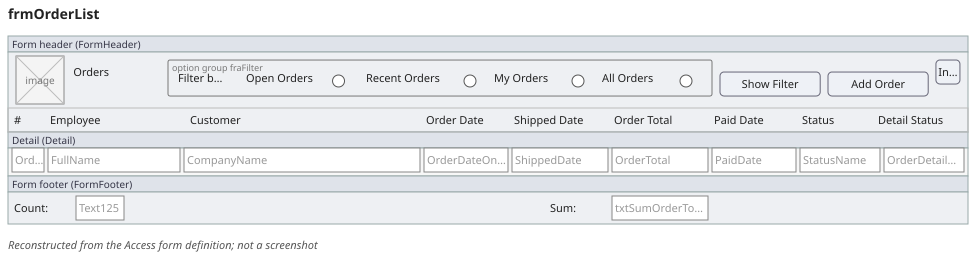

*Reconstructed from the Access form definition; not a screenshot.*

### frmOrderDetails

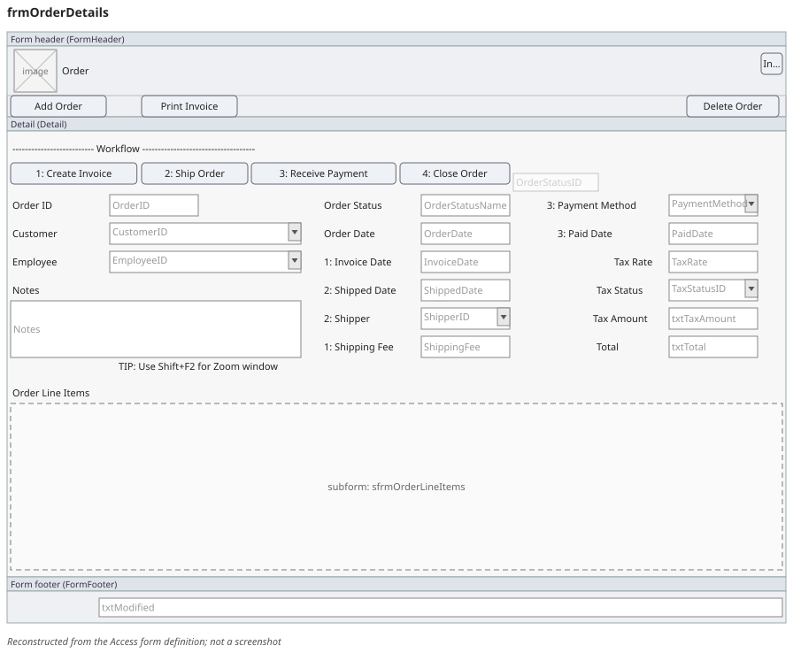

*Reconstructed from the Access form definition; not a screenshot.*

### sfrmOrderLineItems

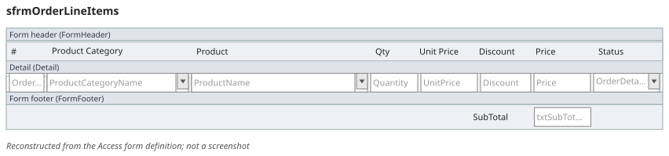

*Reconstructed from the Access form definition; not a screenshot.*

## inventory_restock: Inventory levels and restocking

### frmProductList

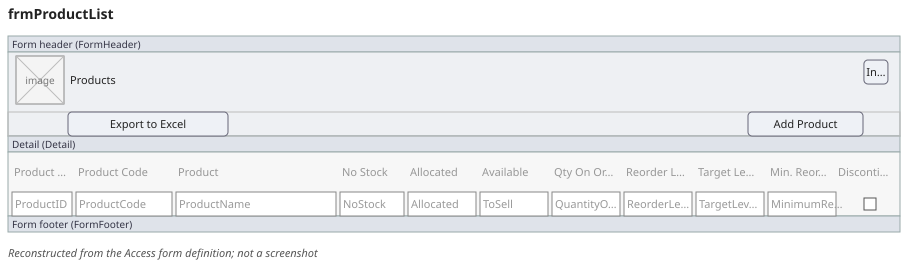

*Reconstructed from the Access form definition; not a screenshot.*

### frmProductDetail

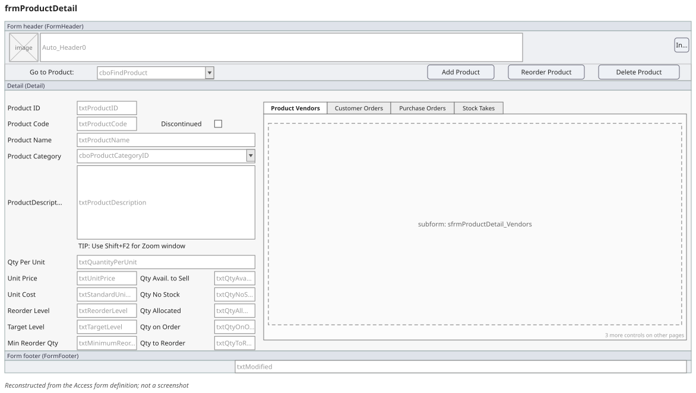

*Reconstructed from the Access form definition; not a screenshot.*

### sfrmProductDetail_StockTake

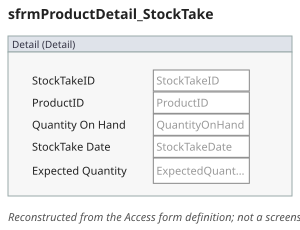

*Reconstructed from the Access form definition; not a screenshot.*

### sfrmProductDetail_Vendors

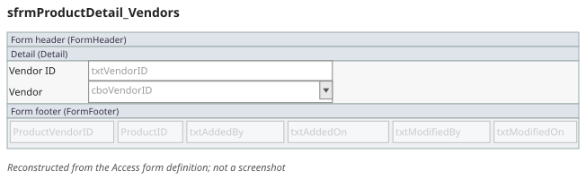

*Reconstructed from the Access form definition; not a screenshot.*

### sfrmProductDetail_PurchaseOrders

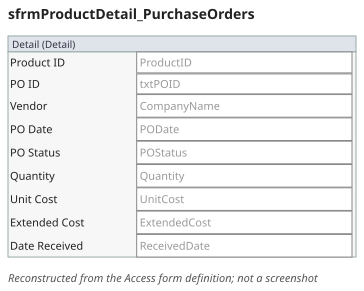

*Reconstructed from the Access form definition; not a screenshot.*

### frmSelectVendorDialog

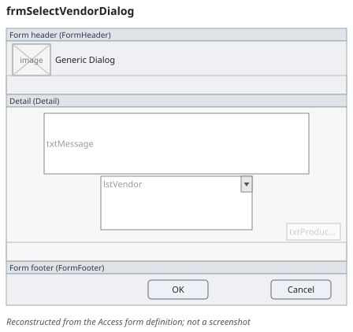

*Reconstructed from the Access form definition; not a screenshot.*

### frmPurchaseOrderDetails

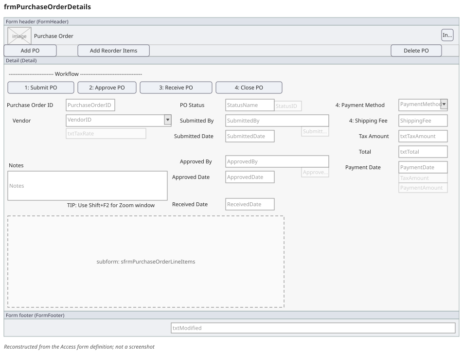

*Reconstructed from the Access form definition; not a screenshot.*

## purchase_order_to_stock: Purchase order to receiving to stock update

### frmPurchaseOrderList

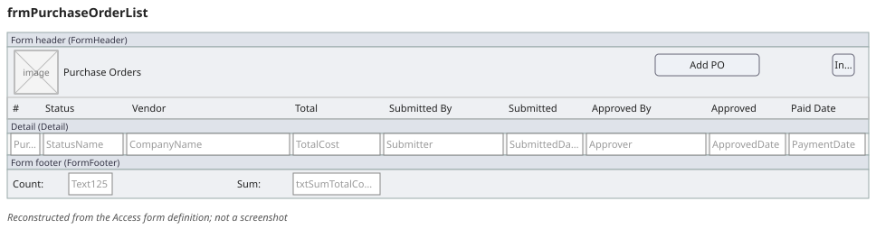

*Reconstructed from the Access form definition; not a screenshot.*

### frmPurchaseOrderDetails

*Reconstructed from the Access form definition; not a screenshot.*

### sfrmPurchaseOrderLineItems

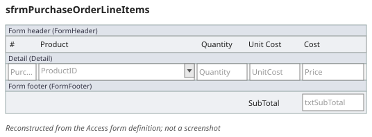

*Reconstructed from the Access form definition; not a screenshot.*

## kept_reports: The invoice and the four chosen reports

### frmOrderDetails

*Reconstructed from the Access form definition; not a screenshot.*

### frmReports

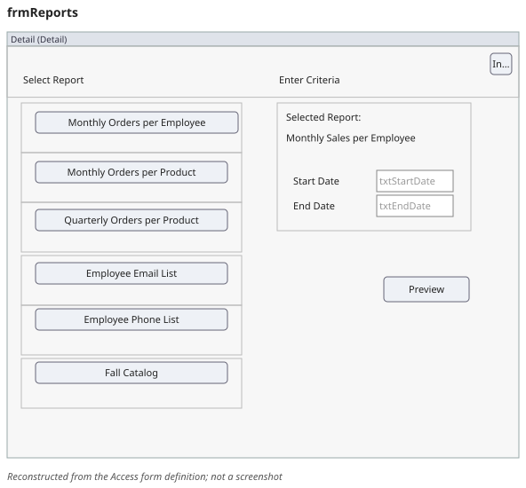

*Reconstructed from the Access form definition; not a screenshot.*
